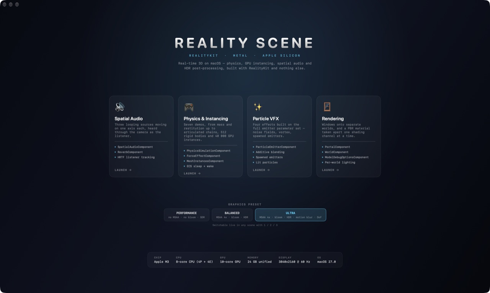
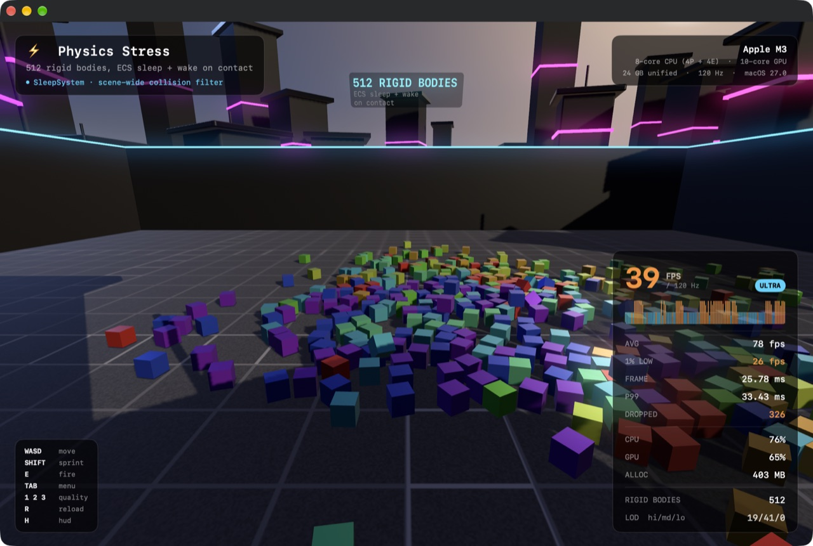
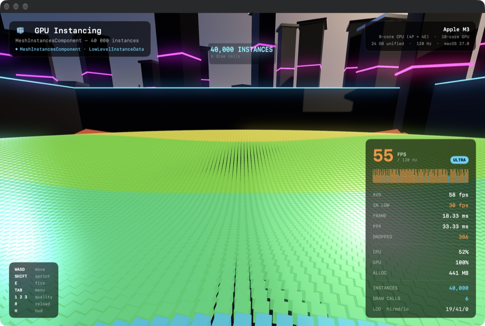
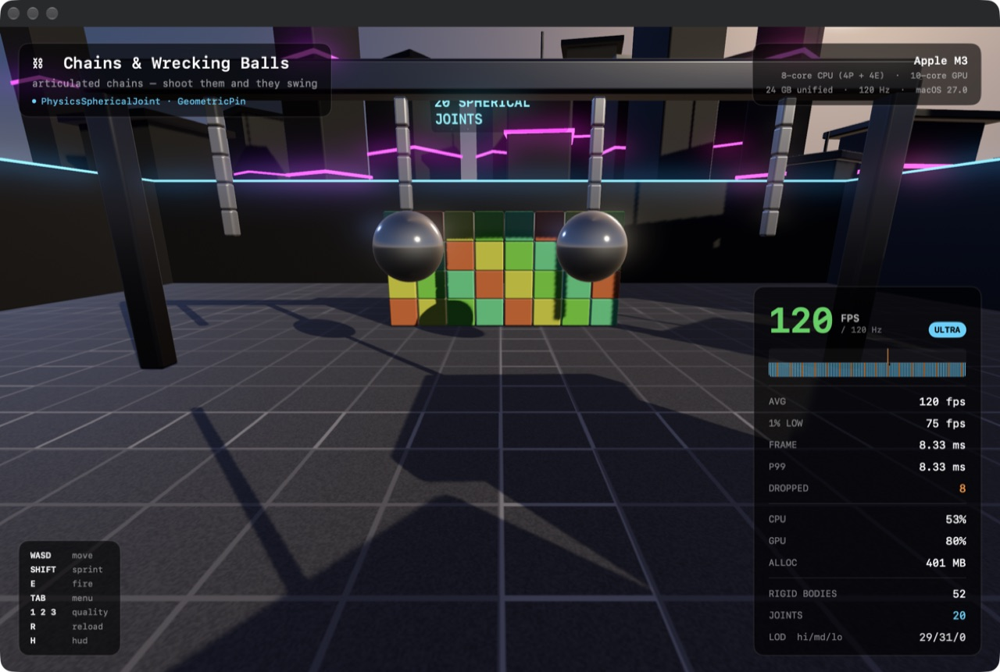
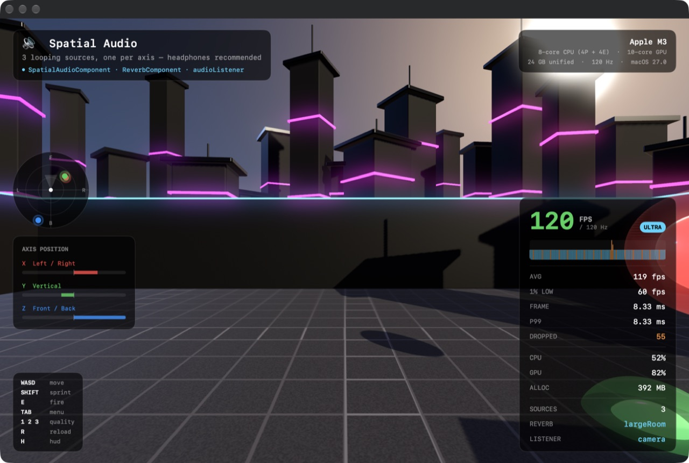
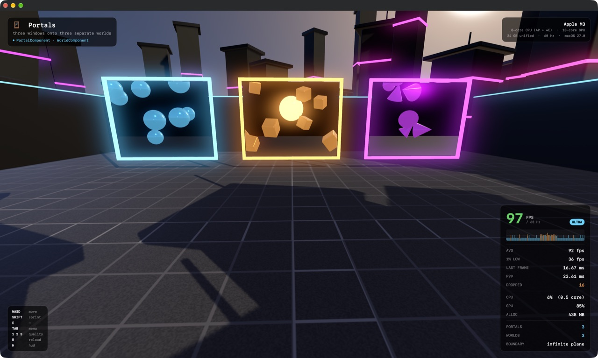
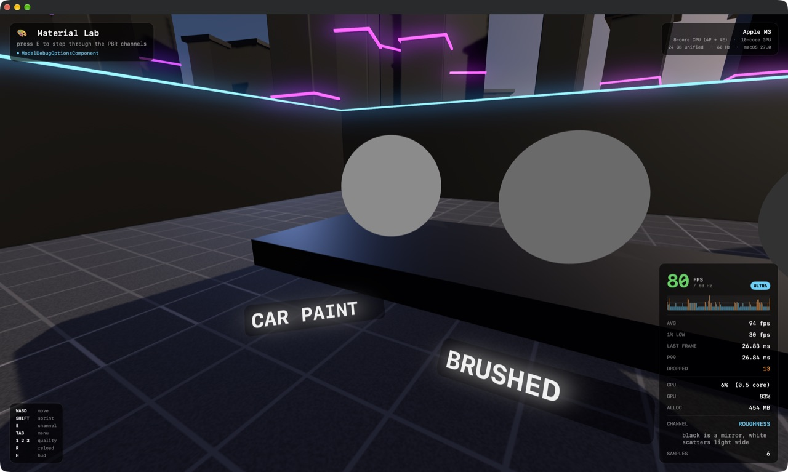
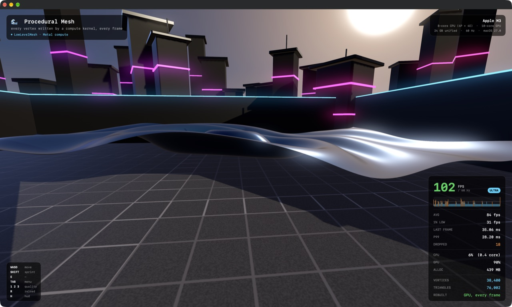

# Reality Scene

**Real-time 3D on macOS, built with RealityKit and nothing else.**
No engine, no packages, no asset files — and it tells you exactly what it costs.



macOS 27 · Swift 6.4 · RealityKit · SwiftUI · zero dependencies

---

## Why this exists

"Macs can't do games" is usually argued with vibes. This argues with numbers.

Every scene here runs on Apple's own frameworks and reports its own frame
times, 1% lows, CPU and real GPU utilisation while it runs. You can disagree
with the conclusion, but you can reproduce the measurement — the app
benchmarks itself from the command line.

The sky, the image-based lighting and the floor texture are all generated in
code at launch. The only files in the bundle are six `.m4a` sounds.

---

## The demos

### 512 rigid bodies, with an ECS sleep pass



Eight by eight by eight dynamic bodies, dropped and then hit with a 50 kg
ball. A custom `SleepSystem` parks bodies as static once they settle and wakes
them again on contact, so the solver stops paying for a cube that has stopped
moving but it still reacts when something hits it.

### 40 000 instances in 6 draw calls



`MeshInstancesComponent` with `LowLevelInstanceData`: one mesh, one buffer of
per-instance transforms, six draw calls for the whole field. The wave radiates
from wherever you are standing, so walking across it pushes the ripple ahead
of you. Every transform is rewritten on the CPU each frame.

### Articulated chains



Four chains hanging from a gantry on `PhysicsSphericalJoint`, two of them
carrying wrecking balls. Press **E** and shoot them.

### Spatial audio you can see



Three looping sources, one per axis, with the camera set as
`content.audioListener` — so turning your head changes what you hear. Each
source emits a visible shell, because a recording of a spatial audio demo
otherwise shows three spheres sliding around in silence.

### Windows onto other worlds



`WorldComponent` takes an entity and its descendants out of the default world:
they render nowhere except through a `PortalComponent` that targets them. Each
of the three worlds here has its own floor, its own lights and its own palette.

### A PBR material, one channel at a time



The roughness channel, above: the polished sphere and the glass read almost
black because they are mirrors, the rough one almost white because it scatters
light wide. `ModelDebugOptionsComponent` replaces an entity's shading with a single channel
of it. Stepping through base colour, normals, roughness, metallic, clearcoat
and the diffuse and specular lighting terms on a row of deliberately different
materials shows *why* car paint and brushed metal catch light the way they do.
Press **E** to advance a channel.

### A mesh with no vertices on the CPU



`LowLevelMesh` lets you declare a vertex layout and own the memory.
`replace(bufferIndex:using:)` hands that memory back as an `MTLBuffer`, so the
38 400 positions and normals of this surface are written by a compute kernel on
the same GPU that is about to draw them. The indices are written once — the
grid's topology never changes — and nothing is ever uploaded: the only thing
crossing from Swift is nine floats of parameters. Normals come from central
differences on the height field rather than from averaging face normals, which
is cheaper and leaves no seams.

### A shooting range, as a benchmark load

Every other demo here measures one kind of work, and a fair objection to all
of them is that a game is not shaped like that. A game is spawning, physics,
collisions, audio and rendering competing for the same frame, continuously.
So this one does all of it at once: eighteen targets that rise and drop,
clays launched every 0.35 s, scoring through a single scene-wide collision
subscription, and the full post-processing stack over the top.

It has to produce that load with nobody at the keyboard, because a
`--benchmark` run has no player. The clays launch themselves and the targets
stand themselves back up; shooting it only moves the score, and the score is
the part that does not matter. Press **E** anyway.

Plus: mass and restitution, breakable glass, tower collapse, vortex and
turbulence force fields, and four particle effects.

---

## Performance

MacBook Pro · Apple M3 · 8-core CPU (4P + 4E) · 10-core GPU · 24 GB unified ·
macOS 27.2 · **Release build** · rendered into a 3200x2000 px window on a
120 Hz panel · `./benchmark.sh 10 3`.

Three passes per row, interleaved rather than repeated in place, so each row
is sampled once on a cool chip, once warm and once hot. **Avg** is the median
of the three; **min** and **max** are the slowest and fastest pass behind it.
All 54 passes measured — none was discarded.

| Demo | Preset | Avg | Min–Max | 1% low | p99 | Dropped | CPU | GPU |
|---|---|---:|---:|---:|---:|---:|---:|---:|
| Material lab | Ultra | 119.4 | 94.9–119.9 | 80.0 | 8.3 ms | 6 | 3% | 77% |
| Rain | Ultra | 119.3 | 80.7–119.4 | 74.9 | 8.3 ms | 7 | 4% | 72% |
| Portals, 3 worlds | Ultra | 118.7 | 78.9–119.4 | 57.6 | 8.3 ms | 11 | 5% | 75% |
| Mass & bounce | Ultra | 114.6 | 88.7–119.1 | 39.6 | 24.6 ms | 36 | 6% | 72% |
| Breakable glass | Ultra | 109.6 | 67.8–117.9 | 36.6 | 25.2 ms | 62 | 6% | 75% |
| Snow | Ultra | 103.6 | 87.6–119.6 | 39.4 | 25.2 ms | 99 | 6% | 74% |
| Procedural surface | Ultra | 92.7 | 68.6–94.1 | 38.0 | 26.1 ms | 164 | 6% | 81% |
| **Shooting range** | Ultra | **92.0** | 83.1–112.1 | 39.1 | 25.4 ms | 174 | 6% | 77% |
| Spatial audio | Ultra | 72.8 | 63.5–85.1 | 35.6 | 26.2 ms | 304 | 6% | 80% |
| Tower collapse | Ultra | 62.3 | 49.5–105.2 | 38.5 | 25.7 ms | 325 | 5% | 79% |
| Sparks | Ultra | 47.4 | 42.5–48.0 | 35.8 | 25.8 ms | 397 | 7% | 65% |
| 512 rigid bodies | Performance | 44.6 | 43.0–46.9 | 38.5 | 25.7 ms | 389 | 7% | 64% |
| Fire | Ultra | 42.5 | 41.7–44.4 | 37.9 | 25.7 ms | 414 | 5% | 78% |
| Force fields, 150 bodies | Ultra | 41.7 | 41.2–42.2 | 29.9 | 25.8 ms | 398 | 6% | 68% |
| **40 000 instances** | Ultra | **40.7** | 39.6–45.5 | 26.1 | 28.4 ms | 399 | 5% | **95%** |
| 512 rigid bodies | Balanced | 40.6 | 40.1–40.9 | 30.8 | 27.7 ms | 397 | 7% | 63% |
| Chains, 20 joints | Ultra | 40.1 | 40.0–40.3 | 30.6 | 25.9 ms | 403 | 5% | 79% |
| **512 rigid bodies** | Ultra | **40.0** | 39.9–40.9 | 29.6 | 32.8 ms | 393 | 7% | 64% |

### Why so many rows sit at 40

Look at the bottom of the table: 40.0, 40.1, 40.6, 40.7, 41.7, 42.5. Six
demos doing completely different work, landing within two frames a second of
each other. That is not six coincidences, it is vsync.

With vsync on, a frame is presented on a refresh boundary or it waits for the
next one. On a 120 Hz panel the only frame times available are 8.33 ms,
16.67 ms, 25.0 ms, 33.3 ms — so the only frame rates available are **120, 60,
40 and 30**. A demo that cannot finish a frame in 16.67 ms does not degrade
to 55; it falls to the next step down and sits there. The p99 column shows it
directly: every row in that cluster reports about 25.8 ms, which is three
refresh intervals, and every row at the top reports exactly 8.33 ms, which is
one.

It also explains why a row moves between sweeps. Force fields measured 71.4
on an earlier sweep and 41.7 here, and the tower ranges 49.5–105.2 across its
own three passes. Those demos sit near the 16.67 ms boundary, so a small
change in load pushes them from the 60 step to the 40 step and the average
halves. The ones with tight spreads — chains at 40.0–40.3, force fields at
41.2–42.2 — are the ones sitting *well* past the boundary, where there is
nothing to be bistable about.

Read the table as steps, then: six demos hold the panel's full 120, and the
rest sit on the 60 or 40 step.

### Reading the other columns

**The CPU column is the whole machine**, all eight cores, which is why it
reads 3–7% and not the 50–80% an earlier version of this table claimed. That
older number came from summing per-thread utilisation, where each thread is a
fraction of *one* core; adding those up and calling it a percentage of the
Mac overstated it by roughly eight times. 7% of this machine is about half a
single core.

That matters for reading the physics rows. **512 rigid bodies runs at 40.0
with the GPU at 64% and the machine 93% idle**, so neither column is the
wall. RealityKit steps the solver on one thread, and half a core is what that
thread costs; the frame cannot present until it finishes, no matter how many
cores sit free beside it. The benchmark measures the process, not individual
threads, so take that as the reading it is rather than a measurement.

**40 000 instances is the one unambiguous case: GPU-bound at 95%.** Cutting
the count barely helps — 10 000 cubes only reached 73 fps in isolation. The
cost is fill rate and sub-pixel triangles across half the screen, not the
instancing itself. Six draw calls for 40 000 objects is doing its job; the
rasteriser is the wall.

**The shooting range is the row that answers "but a game is different".**
Every other demo measures one kind of work. The range runs continuous
spawning, rigid-body physics, collision scoring, spatial audio and the full
post-processing stack at the same time, which is the mixture an actual game
puts in a frame — and it holds 92 fps. It also produces that load with nobody
at the keyboard, because a benchmark run has no player: the clays launch
themselves and the targets stand themselves back up. Shooting it only moves
the score.

### Measuring this honestly took more work than the demos

Every number above is the output of `benchmark.sh`, and getting that script
to tell the truth took six corrections, each of which had already produced
plausible-looking results that were wrong:

- **It averaged its last 240 frames, not the run.** That window is the right
  shape for a HUD and the wrong shape for a result: at 120 fps it is two
  seconds of a ten-second run. The procedural surface measured 47.8, 110.8,
  72.8 and 55.3 fps on four runs of the same scene before this was fixed, and
  66.0–72.0 after.
- **It called a slow demo a throttled one.** An invalid run was detected by
  counting frames — fewer than a quarter of the display's meant trouble —
  which cannot tell a throttled window from a demo honestly running at 22 fps.
  It now asks AppKit whether the window was occluded or the app was in the
  background, and says which, and for how long.
- **It measured a sleeping screen.** macOS reports every window as not
  visible once the display sleeps. A sweep takes a quarter of an hour and
  asks to be left alone, so the screen goes dark partway through and
  everything after it is throttled. Two full passes were lost to this before
  the script learned to wake the display and hold it awake.
- **It read the CPU and GPU once, at the moment the run ended.** For a demo
  that settles, that is the least informative instant it has: by the end of
  the stress test the ball has stopped, `SleepSystem` has parked all 512
  bodies and the solver is doing nothing, so the summary printed 8% of the
  machine under a run whose load had peaked at 89%. Both readings were true;
  only one of them described the demo. Those columns are now the peak across
  the whole run, with the mean printed beside it.
- **It pinned the window in points, not pixels.** Pinning the window at all
  is the right instinct — every scene here is fill-rate bound — but a
  1600x1000 *point* window is 6.4 megapixels on a Retina panel in its HiDPI
  mode and 1.6 on the same panel at 1:1 native. The stress test came out at
  49 fps under one Display setting and 105 under the other, on the same
  machine, on the same afternoon, with nothing else changed. The target is
  now a pixel count, clamped to what the screen can actually hold, and the
  summary reports both the surface it got and the scale it was measured at.
- **It did not say when the machine was busy.** An entire sweep was run while
  macOS staged a six gigabyte system update in the background, with `installd`
  at 84% of a core. Every demo came out low enough to look like a regression
  in this project, and nothing in the output said why. The script now names
  the machine it measured and warns, before the first run, about anything
  else using it.

### What changed

The 512-body test started this rewrite at **17.9 fps**. Three changes took it
to 114 in isolation, and none of them were about the hardware:

| Change | Avg fps |
|---|---:|
| starting point | 17.9 |
| plain boxes instead of `generateBox(cornerRadius:)` | 69.4 |
| 6 solver iterations, no redundant component writes | 92.2 |
| collision wake handled inline instead of a `Task` per contact | 114.3 |

These four, and the clearcoat figure below, were all measured before the
benchmark was fixed to average the whole run instead of its last two
seconds, so they read high and do not line up with the 48.7 in the table
above. They were taken the same way as each other, which is what makes the
progression meaningful; they are not comparable with anything measured
since. Re-running them is not possible — each belongs to a state of the
code that no longer exists.

Clearcoat is the same kind of trap. On the procedural surface, which covers
most of the lower screen, a `clearcoat` of 0.6 cost **48 fps against 118** —
the second specular lobe is evaluated per pixel, and on a surface already
metallic and smooth it was invisible. One material parameter, 2.4x the frame
rate.

The rounded-corner box was the big one. It carries a far heavier triangle
count than a plain box, and with every cube also drawn once per shadow
cascade, that single parameter cost more than everything else combined.

It bites twice, too: `MeshInstancesComponent` silently refuses a mesh built
with `generateBox(cornerRadius:)`. The component is accepted, the instance
counters all read correctly, the system keeps writing transforms every frame
— and nothing is ever drawn. The instancing demo reported a confident 120 fps
for a while because it was rendering an empty field.

---

## Run it

```bash
open RealityEsceneTestV3.xcodeproj
```

Build **Release** for anything you intend to record or quote. A Debug build
runs roughly a third of the speed and its frame graph is not representative.

### Benchmark it yourself

```bash
./benchmark.sh 10 3
```

Ten seconds per run, three passes per row. Builds Release, names the machine
it is about to measure, warns if anything else is using it, wakes the display
and holds it awake, runs every demo, prints a table. No interaction.

Leave the Mac alone while it runs — it takes about a quarter of an hour at
those settings, and a row measured while you were doing something else is a
row about something else. The script tells you when that happened rather than
quietly printing the number.

With one pass (`./benchmark.sh 10`) the min and max columns are dropped.
Individual runs:

```bash
RealityEsceneTestV3.app/Contents/MacOS/RealityEsceneTestV3 \
  --scene physics --mode stress --quality ultra --benchmark 10
```

| Flag | Values |
|---|---|
| `--scene` | `physics` · `particles` · `audio` · `rendering` |
| `--mode` | `balls` · `breakable` · `tower` · `joints` · `forcefield` · `stress` · `instancing` · `shooter` |
| `--effect` | `rain` · `snow` · `fire` · `sparks` |
| `--showcase` | `portals` · `materials` · `surface` |
| `--channel` | `basecolor` · `normal` · `roughness` · `metallic` · `clearcoat` · `ao` · `diffuse` · `specular` |
| `--quality` | `auto` · `performance` · `balanced` · `ultra` |
| `--benchmark` | seconds to measure, then print and quit |

`--quality auto` picks one of the three presets from the window's pixel count,
and picks again if the window is resized or dragged onto a display with a
different scale: ULTRA up to 9 megapixels, BALANCED to 16, PERFORMANCE above
that. It resolves to a named preset instead of scaling continuously, and the
summary prints which one it chose — `--quality ultra` has to mean the same
thing on every machine or none of the rows above can be compared with each
other. The three fixed presets never adapt to anything.

### Controls

| Key | |
|---|---|
| `WASD` / `SHIFT` | move / sprint |
| `E` | fire a projectile from the camera |
| `TAB` | pause menu — change demo, change quality |
| `1` `2` `3` | graphics preset, live |
| `R` / `H` | reload demo / toggle HUD |
| `ESC` | release the mouse |

---

## What it uses

### Rendering

| | |
|---|---|
| `EnvironmentResource` | sky and image-based lighting generated at runtime as a 32-bit float equirectangular map — no HDRI in the bundle |
| `BloomComponent` + `BloomOptionsComponent` | HDR highlight bleed, threshold-driven |
| `ToneMappingComponent` | filmic curve, exposure in f-stops |
| `DirectionalLightComponent.Shadow` | cascaded shadow maps, distance bound to the quality preset |
| `renderingEffects` | MSAA 4x, HDR output, motion blur, depth of field |
| `LevelOfDetailComponent` | the skyline swaps between three detail levels by camera distance |
| `PhysicallyBasedMaterial` | clearcoat, anisotropy, specular, emissive |
| `TextComponent` + `BillboardComponent` | in-world captions that always face the camera |
| `PortalComponent` + `WorldComponent` | three windows onto three separate worlds, each with its own floor and lights |
| `ModelDebugOptionsComponent` | a PBR material taken apart one shading channel at a time |
| `LowLevelMesh` | a 38 400-vertex surface whose positions and normals are rewritten by a Metal compute kernel every frame |

### Physics

| | |
|---|---|
| `PhysicsSimulationComponent` | explicit solver budget |
| `PhysicsSphericalJoint` + `GeometricPin` | articulated chains |
| `ForceEffectComponent` | vortex, radial and turbulence fields |
| `MeshInstancesComponent` | 40 000 animated cubes in six draw calls |
| `SleepSystem` (custom ECS) | parks settled bodies, wakes them on contact |

### Audio

`SpatialAudioComponent` with per-source gain, rolloff and reverb send ·
`ReverbComponent` on the scene root · the camera as `audioListener`.

### Measurement

Average and 1% low FPS against the display's own refresh rate, frame time,
p99, dropped frames, CPU, and real GPU utilisation read from the accelerator's
`PerformanceStatistics` through IOKit. Sampling runs off the render thread and
the first 45 frames after a scene loads are discarded.

---

## Notes

- Requires **macOS 27**. Bloom, tone mapping, `LevelOfDetailComponent` and
  runtime `EnvironmentResource` creation are macOS 27 APIs.
- Everything renders on Metal, because RealityKit renders on Metal. Two compute
  kernels here are hand-written: one fills the instancing field's 40 000
  transforms, the other builds the procedural surface's vertices. Both reach
  the GPU through the `replace(using:)` pattern RealityKit exposes on
  `LowLevelInstanceData` and `LowLevelMesh`, so nothing is uploaded per frame.
- The target builds with `SWIFT_DEFAULT_ACTOR_ISOLATION = MainActor`; anything
  that must leave the main actor says `nonisolated` explicitly.

---

## How this was built

V1 and V2 of this project were written by hand. This version — the rendering
pipeline, the ECS systems, the instancing, the joints, the measurement stack
and this README — was written by Claude (Anthropic) in a single working
session, against the real macOS 27 SDK, with every API verified by reading the
framework's own symbol graph rather than recalled from memory.

Everything in the performance section was measured by the app on this machine,
including the parts that do not flatter it. The instancing bug above was found
the same way: by taking a screenshot and noticing that a demo reporting 120 fps
was drawing nothing at all.

---

## Links

- V1: [RealityKitGames](https://github.com/BurgerMike/RealityKitGames)
- V2: [RealityEsceneTestV2](https://github.com/BurgerMike/RealityEsceneTestV2)
- YouTube: [@SpatialWorkshop](https://www.youtube.com/@SpatialWorkshop)
