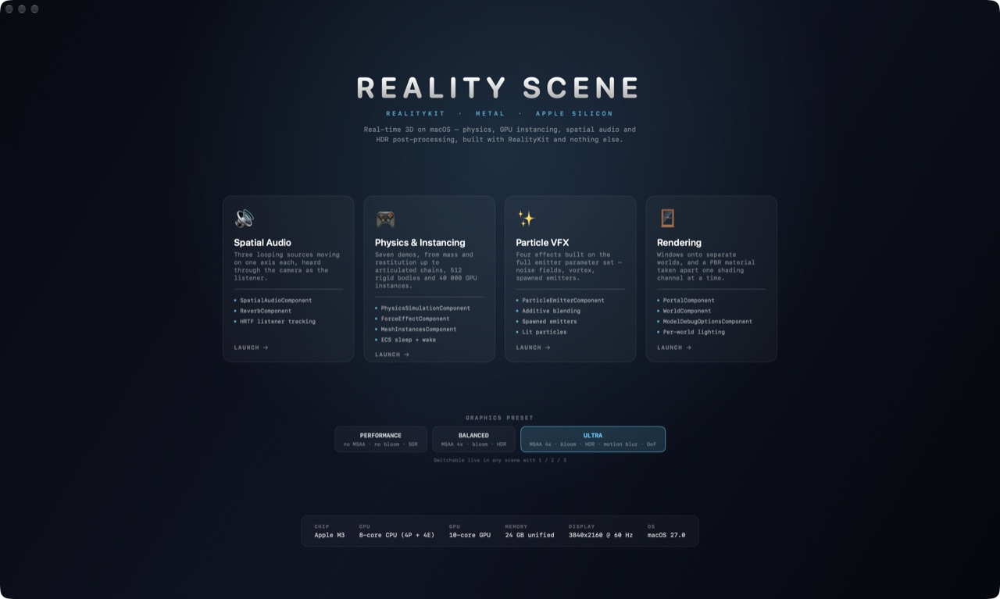
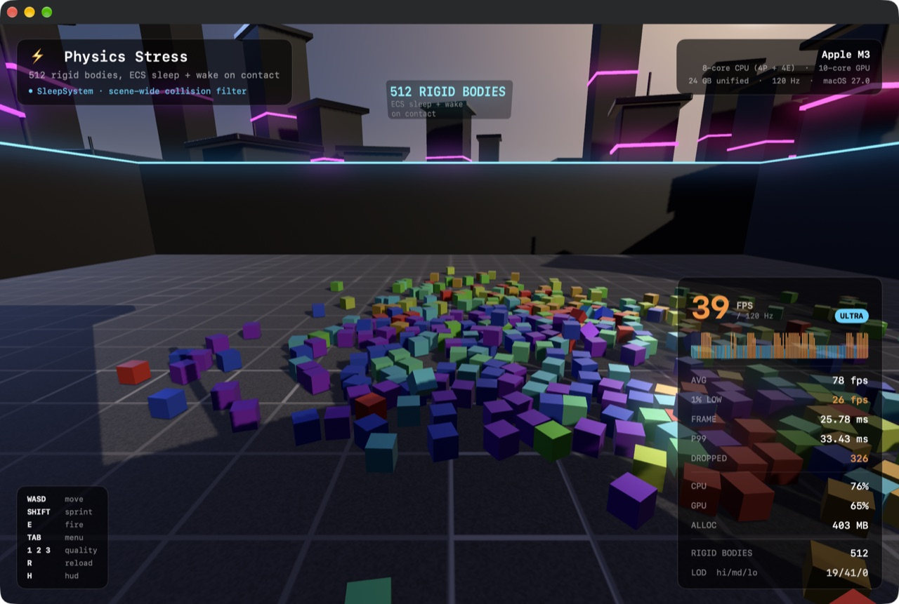
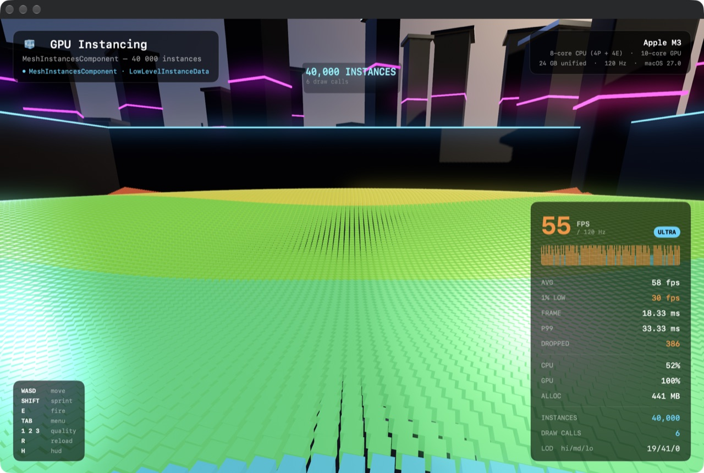
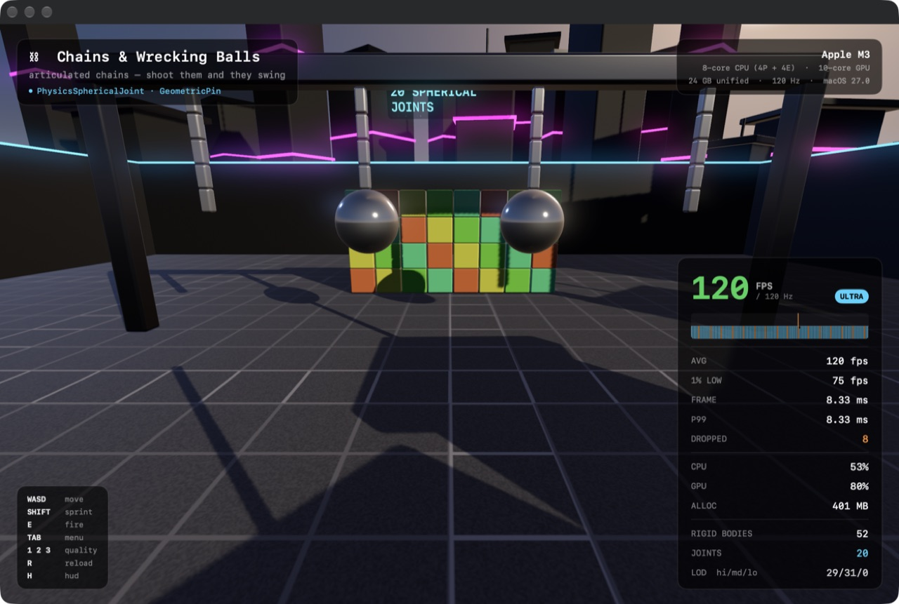
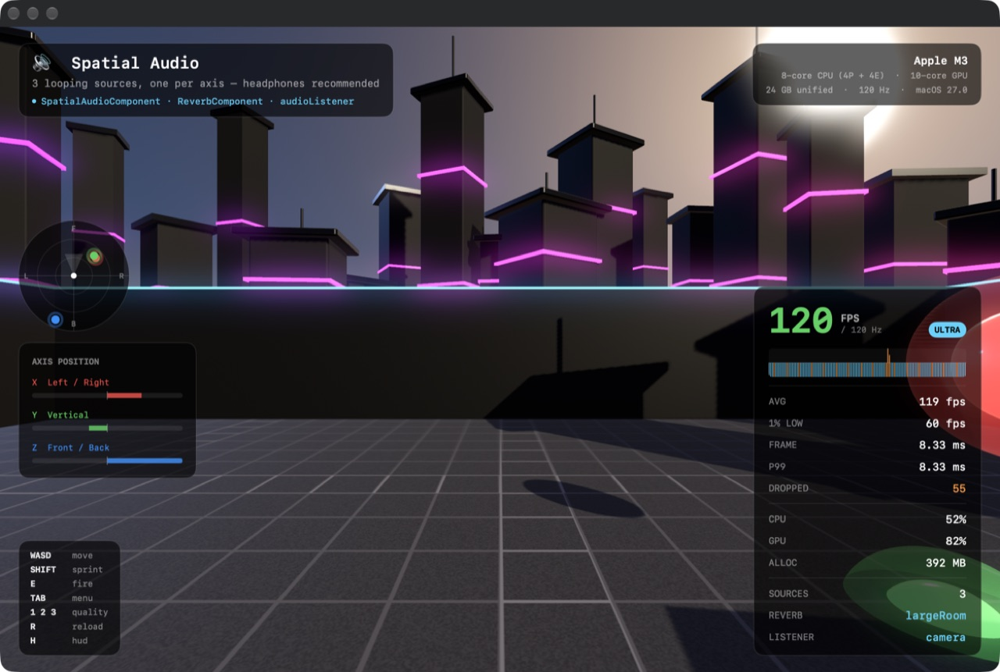

# Reality Scene

**Real-time 3D on macOS, built with RealityKit and nothing else.**
No engine, no packages, no asset files — and it tells you exactly what it costs.



macOS 27 · Swift 6.2 · RealityKit · SwiftUI · zero dependencies

---

## Why this exists

"Macs can't do games" is usually argued with vibes. This argues with numbers.

Every scene here runs on Apple's own frameworks and reports its own frame
times, 1% lows, CPU and real GPU utilisation while it runs. You can disagree
with the conclusion, but you can reproduce the measurement — the app
benchmarks itself from the command line.

The sky, the image-based lighting and the floor texture are all generated in
code at launch. The only files in the bundle are six `.m4a` sounds.

---

## The demos

### 512 rigid bodies, with an ECS sleep pass



Eight by eight by eight dynamic bodies, dropped and then hit with a 50 kg
ball. A custom `SleepSystem` parks bodies as static once they settle and wakes
them again on contact, so the solver stops paying for a cube that has stopped
moving but it still reacts when something hits it.

### 40 000 instances in 6 draw calls



`MeshInstancesComponent` with `LowLevelInstanceData`: one mesh, one buffer of
per-instance transforms, six draw calls for the whole field. The wave radiates
from wherever you are standing, so walking across it pushes the ripple ahead
of you. Every transform is rewritten on the CPU each frame.

### Articulated chains



Four chains hanging from a gantry on `PhysicsSphericalJoint`, two of them
carrying wrecking balls. Press **E** and shoot them.

### Spatial audio you can see



Three looping sources, one per axis, with the camera set as
`content.audioListener` — so turning your head changes what you hear. Each
source emits a visible shell, because a recording of a spatial audio demo
otherwise shows three spheres sliding around in silence.

Plus: mass and restitution, breakable glass, tower collapse, vortex and
turbulence force fields, and four particle effects.

---

## Performance

MacBook Pro · Apple M3 · 8-core CPU (4P + 4E) · 10-core GPU · 24 GB unified ·
120 Hz display · macOS 27 · **Release build** · one back-to-back sweep of
`./benchmark.sh 10`.

| Demo | Preset | Avg | 1% low | p99 | CPU | GPU |
|---|---|---:|---:|---:|---:|---:|
| Mass & bounce | Ultra | 112.1 | 32.7 | 19.6 ms | 49% | 72% |
| Breakable glass | Ultra | 108.3 | 23.2 | 23.0 ms | 49% | 76% |
| Tower collapse | Ultra | 112.5 | 42.0 | 19.6 ms | 51% | 73% |
| Chains, 20 joints | Ultra | 109.5 | 36.2 | 27.6 ms | 59% | 77% |
| Force fields, 150 bodies | Ultra | 106.4 | 35.7 | 25.7 ms | 58% | 70% |
| **512 rigid bodies** | Ultra | **54.1** | 29.6 | 33.5 ms | **76%** | 68% |
| 512 rigid bodies | Balanced | 84.5 | 29.7 | 28.0 ms | 79% | 63% |
| 512 rigid bodies | Performance | 74.2 | 29.6 | 33.4 ms | 71% | 67% |
| **40 000 instances** | Ultra | **29.9** | 15.2 | 61.9 ms | 37% | **96%** |
| Rain | Ultra | 112.9 | 37.6 | 21.5 ms | 51% | 74% |
| Snow | Ultra | 115.2 | 51.6 | 19.1 ms | 53% | 76% |
| Fire | Ultra | 119.0 | 60.0 | 8.3 ms | 49% | 77% |
| Sparks | Ultra | 119.0 | 60.0 | 8.3 ms | 74% | 70% |
| Spatial audio | Ultra | 104.0 | 28.6 | 27.5 ms | 65% | 70% |

Eleven of the fourteen hold above 100 fps on a 120 Hz panel with MSAA 4x, HDR,
bloom, motion blur and depth of field all on. The three that do not are the
ones built to saturate something, and the CPU and GPU columns say which:

- **512 rigid bodies is CPU-bound.** The solver and the per-body work are the
  cost; the GPU sits at 68%. Dropping the shadow distance (the Balanced
  preset) buys more than dropping the post-processing does.
- **40 000 instances is GPU-bound at 96%**, and reducing the count barely
  helps — 10 000 cubes only reached 73 fps in isolation. The cost is fill
  rate and sub-pixel triangles across half the screen, not the instancing.
  Six draw calls for 40 000 objects is doing its job; the rasteriser is the
  wall.

Two honest caveats. These are back-to-back runs, so the later ones measure a
warmer chip — the same instancing scene measures around 52 fps on a cool
machine. And the physics demos are chaotic: where the ball lands changes the
result, so the 512-body test has ranged from 54 to 120 fps across runs. That
is exactly why the benchmark ships with the app instead of being a number in
a README.

### What changed

The 512-body test started this rewrite at **17.9 fps**. Three changes took it
to 114 in isolation, and none of them were about the hardware:

| Change | Avg fps |
|---|---:|
| starting point | 17.9 |
| plain boxes instead of `generateBox(cornerRadius:)` | 69.4 |
| 6 solver iterations, no redundant component writes | 92.2 |
| collision wake handled inline instead of a `Task` per contact | 114.3 |

The rounded-corner box was the big one. It carries a far heavier triangle
count than a plain box, and with every cube also drawn once per shadow
cascade, that single parameter cost more than everything else combined.

It bites twice, too: `MeshInstancesComponent` silently refuses a mesh built
with `generateBox(cornerRadius:)`. The component is accepted, the instance
counters all read correctly, the system keeps writing transforms every frame
— and nothing is ever drawn. The instancing demo reported a confident 120 fps
for a while because it was rendering an empty field.

---

## Run it

```bash
open RealityEsceneTestV3.xcodeproj
```

Build **Release** for anything you intend to record or quote. A Debug build
runs roughly a third of the speed and its frame graph is not representative.

### Benchmark it yourself

```bash
./benchmark.sh 10
```

Builds Release, runs every demo, prints a table. Each run measures itself and
quits — no interaction. Individual runs:

```bash
RealityEsceneTestV3.app/Contents/MacOS/RealityEsceneTestV3 \
  --scene physics --mode stress --quality ultra --benchmark 10
```

| Flag | Values |
|---|---|
| `--scene` | `physics` · `particles` · `audio` |
| `--mode` | `balls` · `breakable` · `tower` · `joints` · `forcefield` · `stress` · `instancing` |
| `--effect` | `rain` · `snow` · `fire` · `sparks` |
| `--quality` | `performance` · `balanced` · `ultra` |
| `--benchmark` | seconds to measure, then print and quit |

### Controls

| Key | |
|---|---|
| `WASD` / `SHIFT` | move / sprint |
| `E` | fire a projectile from the camera |
| `TAB` | pause menu — change demo, change quality |
| `1` `2` `3` | graphics preset, live |
| `R` / `H` | reload demo / toggle HUD |
| `ESC` | release the mouse |

---

## What it uses

### Rendering

| | |
|---|---|
| `EnvironmentResource` | sky and image-based lighting generated at runtime as a 32-bit float equirectangular map — no HDRI in the bundle |
| `BloomComponent` + `BloomOptionsComponent` | HDR highlight bleed, threshold-driven |
| `ToneMappingComponent` | filmic curve, exposure in f-stops |
| `DirectionalLightComponent.Shadow` | cascaded shadow maps, distance bound to the quality preset |
| `renderingEffects` | MSAA 4x, HDR output, motion blur, depth of field |
| `LevelOfDetailComponent` | the skyline swaps between three detail levels by camera distance |
| `PhysicallyBasedMaterial` | clearcoat, anisotropy, specular, emissive |
| `TextComponent` + `BillboardComponent` | in-world captions that always face the camera |

### Physics

| | |
|---|---|
| `PhysicsSimulationComponent` | explicit solver budget |
| `PhysicsSphericalJoint` + `GeometricPin` | articulated chains |
| `ForceEffectComponent` | vortex, radial and turbulence fields |
| `MeshInstancesComponent` | 40 000 animated cubes in six draw calls |
| `SleepSystem` (custom ECS) | parks settled bodies, wakes them on contact |

### Audio

`SpatialAudioComponent` with per-source gain, rolloff and reverb send ·
`ReverbComponent` on the scene root · the camera as `audioListener`.

### Measurement

Average and 1% low FPS against the display's own refresh rate, frame time,
p99, dropped frames, CPU, and real GPU utilisation read from the accelerator's
`PerformanceStatistics` through IOKit. Sampling runs off the render thread and
the first 45 frames after a scene loads are discarded.

---

## Notes

- Requires **macOS 27**. Bloom, tone mapping, `LevelOfDetailComponent` and
  runtime `EnvironmentResource` creation are macOS 27 APIs.
- Everything renders on Metal, because RealityKit renders on Metal. There are
  no hand-written `.metal` shaders here — direct Metal use is limited to
  querying the device for its name and allocated memory.
- The target builds with `SWIFT_DEFAULT_ACTOR_ISOLATION = MainActor`; anything
  that must leave the main actor says `nonisolated` explicitly.

---

## How this was built

V1 and V2 of this project were written by hand. This version — the rendering
pipeline, the ECS systems, the instancing, the joints, the measurement stack
and this README — was written by Claude (Anthropic) in a single working
session, against the real macOS 27 SDK, with every API verified by reading the
framework's own symbol graph rather than recalled from memory.

Everything in the performance section was measured by the app on this machine,
including the parts that do not flatter it. The instancing bug above was found
the same way: by taking a screenshot and noticing that a demo reporting 120 fps
was drawing nothing at all.

---

## Links

- V1: [RealityKitGames](https://github.com/BurgerMike/RealityKitGames)
- V2: [RealityEsceneTestV2](https://github.com/BurgerMike/RealityEsceneTestV2)
- YouTube: [@SpatialWorkshop](https://www.youtube.com/@SpatialWorkshop)
